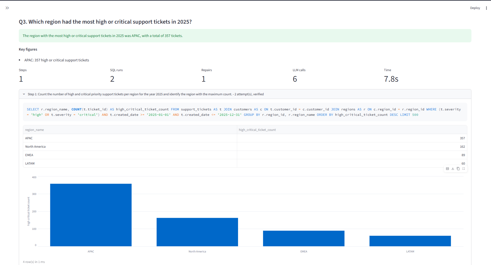
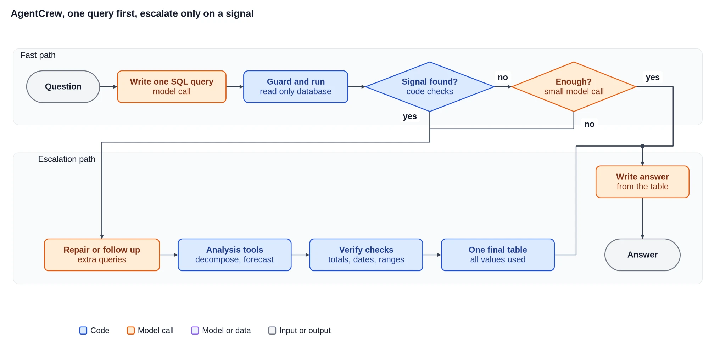
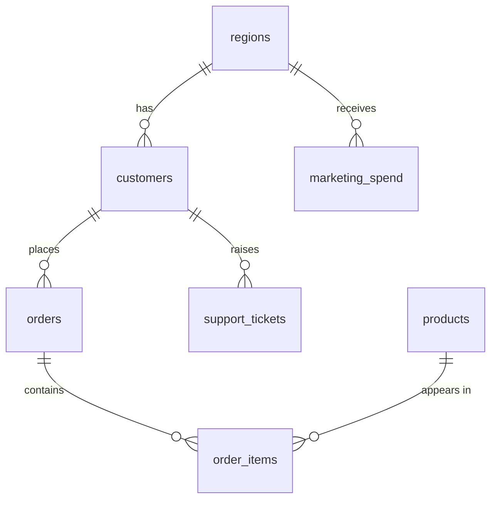

# AgentCrew

[](https://github.com/mohdnayif799/agentic-text-to-sql/actions/workflows/ci.yml)

**An analytics agent that answers plain-English questions about a database with one read-only SQL query when one query is enough, and escalates to repair, exploration and deterministic tools only when a concrete signal says it must.**


Most text-to-SQL questions need exactly one good query. An earlier version of this project ran a full multi-step agent on every question, and a strict re-grade showed a single query beat it. So the current design starts with a single query and adds agent work only where it measurably helps: an error, an empty or suspicious result, a question that asks *why*, or one that asks for a forecast. On a frozen holdout it answered 16 of 21 agent-type questions against 13 for the single-query baseline. That is a win in this sample but not a statistically significant one, and the [evaluation](#evaluation) says so plainly.

---

## Table of contents

- [Why this exists](#why-this-exists)
- [Demo](#demo)
- [A real trace](#a-real-trace)
- [Quick start](#quick-start)
- [Architecture](#architecture)
- [Safety](#safety)
- [Budgets and demo limits](#budgets-and-demo-limits)
- [Observability](#observability)
- [The dataset](#the-dataset)
- [Evaluation](#evaluation)
- [Multi-provider support](#multi-provider-support)
- [MCP server](#mcp-server)
- [Testing](#testing)
- [Project layout](#project-layout)
- [Configuration](#configuration)
- [Known limitations](#known-limitations)
- [Documentation](#documentation)

---

## Why this exists

Asking a language model to write SQL is easy. Trusting the answer is not.

A model that emits a query has no idea whether that query ran, returned nothing, or quietly measured the wrong thing. Pointed at a live database, it will happily generate `DROP TABLE`. An agent that loops on every question fixes some of that, but it pays several times the calls and latency on questions one query answers perfectly well, and every extra step is another chance to go wrong.

AgentCrew takes the middle path. **Anything decidable by code is code**: SQL errors, schema mismatches, join fan-out, empty or all-NULL results, date-format mismatches and the read-only guard are all checked deterministically, at no model cost. The model is called for the parts that need language. It writes the first query, decides whether that result answers the question, plans an escalation, and writes the answer from the final table.

---

## Demo



The app shows, for every question, whether it was answered directly or escalated, the tools each step used, and a progress bar while an escalated question runs (5 to 20 seconds).

---

## A real trace

A why-question from the frozen holdout (ha09), answered by architecture D. The single-query baseline (A) listed revenue per product and named no cause; D escalated and passed.

```text
Q: "Why did Hardware revenue drop so sharply from Q2 to Q3 2025?"

step 1  run_sql                        product revenue, Q2 vs Q3 (9 rows)
        follow-up decision             "...does not explain the underlying cause"  -> escalate
step 2  compute:decompose_change       revenue = orders x AOV = units x price x (1 - discount)
          number of orders      699 -> 238      -66%   largest contributor
          units sold           2,741 -> 778     -72%   largest contributor
          average unit price   1,003 -> 1,009   +0.5%  about the same
          1 - average discount  0.95 -> 0.95    -0.2%  about the same
step 3  compute:contribution_by_dimension  revenue by channel: every channel fell ~71%
final   stack                          the two analyses, one table

answer: "Hardware revenue dropped from 2,615,311.92 to 744,611.11, largely driven by
the number of orders ... units sold dropped from 2,741 to 778 ... average unit price
and 1 - average discount remained about the same ... so they do not explain the
difference."

path=escalated  llm_calls=5  latency 13.0 s (as if live)
```

The decomposition and its SQL are built in code from the data dictionary's metric definitions, never written by the model. The model only chose the metric and the two quarters.

---

## Quick start

```bash
git clone <your-repo-url> && cd agentcrew

python -m venv .venv
source .venv/bin/activate          # Windows: .venv\Scripts\activate

pip install -r requirements.txt
python scripts/build_database.py
streamlit run app.py
```

Enter an API key for Anthropic, OpenAI, or Google Gemini in the sidebar. No `.env` file is required. The key is used only for that session and is never written to disk, logged, or included in traces.

No API key? The test suite runs offline with no network and no model:

```bash
pip install -r requirements-dev.txt
pytest
```

---

## Architecture

Four control flows share one context and differ only in what they do after the first query. `AGENTCREW_ARCH` selects one. The app uses **D** by default.

| | Architecture | What it does |
| --- | --- | --- |
| A | `baseline` | One SQL query from the shared context, one retry only if it errors, then one answer call. |
| B | `v1` (OLD, v1, original LangGraph agent, kept as reference) | The original LangGraph agent: plan, author, execute, triage, verify, repair on every question. Kept as a reference. |
| C | `router` (NEW, router only) | A's exact first query, then escalation on deterministic signals or one small follow-up decision; repair and follow-up queries. |
| D | `full` (NEW, default) | C, plus exploration with lookups and deterministic tools, and verification checks, once it escalates. **Default.** |

**New architecture (default, architecture D): one query first, escalate only on a signal**

<p align="center"></p>

Blue boxes are code, orange boxes are model calls. The old v1 agent (architecture B) is a LangGraph loop and is not shown here, see docs/ARCHITECTURE.md.

**Shared context.** Every SQL-writing call gets the same context:
- the schema, the data's date range and today's date;
- the real values of every low-cardinality text column;
- a YAML data dictionary (definitions, metric formulas, join paths; no facts about the data);
- the two or three most similar verified example questions with their SQL;
- the user's question verbatim.

**D, step by step:**

1. **One query first.** A's query, byte for byte. When it is enough, D answers directly with A's own answer call, so a direct D answer is A's answer.
2. **Escalate only on a signal.** These signals are deterministic and cost no model calls:
   - an SQL error or a guard rejection;
   - an unknown or ambiguous column (sqlglot schema check);
   - a join that fans out an aggregate;
   - an empty result, an all-NULL result, or a result that hit the row cap;
   - a question that asks for a forecast or a fitted trend.

   Otherwise one small structured call decides whether the result answers the question.
3. **Repair with discipline.** A repair sees the exact problem. The original result is kept, and a fix is accepted only if it clears that signal. An SQL error is first retried exactly as A retries it, so D recovers wherever A does.
4. **Explore with tools.** One validated JSON action per step (no free-form tool calling):
   - lookups: `get_distinct_values`, `search_values` (fuzzy match to real values), `sample_rows`;
   - `run_sql`;
   - compute functions: percent change, year-over-year growth, period comparison, share of total, z-score anomalies, linear trend forecast, correlation;
   - metric analyses: `decompose_change` and `contribution_by_dimension`.
5. **Two openings are fixed by rule.** A *why* question starts with a metric decomposition, so every component is compared: a component that stayed flat is stated as such. A *forecast or trend* question starts with the series query and a deterministic fit. The fit uses x = evenly spaced period numbers, and the output states that convention.
6. **Verify.** On the escalated path every query is checked for:
   - count x average = total, within 1%;
   - percentages within 0-100;
   - date-format mismatches (a `'YYYY-MM'` column compared with day dates);
   - query dates that miss the periods the question names.
7. **One final table.** The prose is written from that table only, so every number in the answer can be traced to a row the evaluation also grades.

**Never worse than A when escalation fails.** If every escalated step fails, is rejected or returns nothing usable, D's final table and answer are A's own. An invalid model reply in a repair, decision or follow-up call ends that part of the work, not the run.

The original agent's graph design (B) is documented in [docs/ARCHITECTURE.md](docs/ARCHITECTURE.md).

---

## Safety

Read-only is enforced in **three independent layers**, and the strongest one is not the prompt.

| Layer | Mechanism | What defeats it |
| --- | --- | --- |
| Connection | SQLite opened with `file:...?mode=ro` and `PRAGMA query_only=ON` | Nothing short of editing the source |
| AST | sqlglot parses each statement and walks the whole tree | Nothing; it never reaches the driver |
| Resource | Injected `LIMIT`, 500-row cap, 15-second statement timeout | n/a |

Blocked: `DROP`, `DELETE`, `UPDATE`, `INSERT`, `ALTER`, `CREATE`, `TRUNCATE`, `MERGE`, `PRAGMA`, `ATTACH`, `DETACH`, `VACUUM`, statement batching, and writes hidden inside CTEs.

The SQL that D's metric tools generate goes through the same guard as model SQL. Metric and dimension names are checked against an allowlist before any SQL exists, and values are quoted as literals, never spliced. Tests cover hostile names and every statement the metric layer can build.

Delete every other check and the agent still cannot write, because the handle physically cannot. Ask it to `Delete all customers in the LATAM region.` and watch it refuse.

---

## Budgets and demo limits

- **Per question:** at most 3 steps (the first query counts as one) and 3 attempts per step for A, C and D. B keeps its own budgets (steps, attempts, a 30-call ceiling, a 180-second wall clock) and loop detection.
- **Demo mode:** on the server's key, each browser session gets 5 runs at those fixed budgets. The limits are enforced server-side, whatever the sidebar sends. A visitor's own key is never capped. A quota refusal shows a friendly message and does not use up a demo run.

---

## Observability

- **One log line per run** on stderr: provider, model, architecture, status, path (direct or escalated), the tools of each step (for example `run_sql>compute:decompose_change>stack`), seconds and LLM calls. Never the question text and never a key.
- **Evaluation traces:** every evaluated question writes a trace with every query, result preview, LLM call (live or cached), repair and judge verdict, with keys redacted.
- **B's traces:** the original agent also writes JSONL traces to `data/traces/`, with optional Langfuse forwarding.

---

## The dataset

`scripts/build_database.py` generates **NorthStar**, a 2.1 MB SQLite database of roughly 45,000 rows across seven tables, from a fixed RNG seed. Two independent builds produce byte-identical files.



| Table | Rows |
| --- | --- |
| `regions` | 4 |
| `products` | 36 |
| `customers` | 1,400 |
| `orders` | 11,642 |
| `order_items` | 29,196 |
| `support_tickets` | 2,773 |
| `marketing_spend` | 288 |

The data is not uniform noise. Signals are planted so diagnostic questions have discoverable answers: an APAC churn spike in Q3 2025 and a Hardware-driven revenue decline.

---

## Evaluation

The full method is pre-registered in [eval/PROTOCOL.md](eval/PROTOCOL.md). The final results, with every per-question outcome, are in [eval/results/phase5_report.md](eval/results/phase5_report.md).

**Setup.**
- **Holdouts:** two frozen sets: `holdout_agent` (21 questions, 3 each of multi-hop, term matching, why, statistics, recovery, ambiguous, conditional branch) and `holdout_easy` (12 single-query questions). A SHA-256 manifest froze them before any architecture saw them. They were run once.
- **Gold:** hand-written SQL or pandas, executed and checked. Grading is strict result-set matching; why-questions use a rule-based driver check plus a per-fact judge.
- **Configuration:** every architecture used the same model (Gemini 3.5 Flash-Lite), temperature 0, a fixed "today", the same shared context and the same 3-step / 3-attempt limits.

**holdout_agent (21)**

| | A baseline | B v1 | C router | D full |
| --- | --- | --- | --- | --- |
| Passed | 13 | 9 | 15 | **16** |
| Wilson 95% | 0.41-0.79 | 0.24-0.63 | 0.50-0.86 | 0.55-0.89 |
| LLM calls per question | 2.1 | 5.9 | 3.9 | 3.7 |
| Latency per question (as if live) | 3.8 s | 11.0 s | 6.1 s | 5.7 s |

**holdout_easy (12):** all four architectures pass 12/12. That is a tie; D is not worse than A. Calls per question are A 2.0, B 4.0, C 3.0 and D 3.0; latency is A 3.9 s, B 5.1 s, C 4.9 s and D 4.9 s.

**Paired comparisons** (exact McNemar test on discordant questions):
- **D vs A, the pre-registered primary comparison:** D passes 3 questions A fails and fails none A passes, p = 0.25. **D beats A in this sample, but not significantly**; significance would need at least a 6-0 split.
- **C vs A:** 2-0, p = 0.50.
- **D vs B (secondary):** 8-1, p = 0.039. B is a reference arm and this was not the pre-registered decision. It also depends on how one answer's wording is graded: requiring the conditional branch to be named correctly on ha19 makes it 8-2, p = 0.11.

**Where the gains came from.** Two of D's three wins (a misspelled product name, a trend-residual query that returned nothing) come from the repair step D shares with C. One (a why-question) comes from D's own decomposition tools. D vs C is 1-0.

**Disclosures:**
- **Authorship:** the questions, the gold answers and the agent share an author.
- **Holdout texts were read** during the screening of a development set. The holdout was blind to results, not to its own text.
- **Rules added after development failures:** several were added after failures on the development sets, before the holdout run. They are the metric decomposition tools, why-question decomposition, plain-language component names, the forecast signal and trend plan, retries for provider errors, deterministic metric SQL, and fallback to A's result. Each is listed with the failure that prompted it in the report.
- **Protocol amendments:** three pre-run amendments are recorded in the protocol.
- **Judge and sample size:** the judge is the same model as the one under test, behind rule-based checks. With 21 questions, only large effects are measurable.

**Earlier evaluation.** The original agent (B) was first evaluated with lenient checks. A strict re-grade of the same runs ([eval/results/legacy_v1_strict.md](eval/results/legacy_v1_strict.md)) found the single-query baseline ahead, 13/13 against 11/13. That result is why the design changed to "one query first".

```bash
python scripts/run_eval_v2.py --set holdout_agent --arch baseline router full --run NAME
python scripts/report_v2.py --run NAME
```

Every live call is cached on disk; per-minute rate limits are waited out; a daily-limit stop or a persistent provider error marks the question *not evaluated*, and rerunning the same command resumes.

---

## Multi-provider support

Anthropic, OpenAI, and Google Gemini are all first-class. A single `PROVIDERS` registry is the only place that knows a provider's models, credential field, key format, and install command, so a fourth provider is one dictionary entry plus a client class.

Model selection is scoped per provider in the UI, which makes a provider/model mismatch **structurally impossible** rather than merely validated. A `Custom...` option accepts any model ID.

Key-format validation is provider-appropriate: Anthropic and OpenAI keys are checked against stable prefixes, while Gemini makes **no format assumption**, because Google is mid-migration from `AIza...` to `AQ....` and both are currently valid.

---

## MCP server

The four database tools are also exposed over the Model Context Protocol, so they can be mounted in Claude Desktop, Cursor, or any MCP client with the same read-only guard:

```bash
python mcp_server.py
```

| Tool | Purpose |
| --- | --- |
| `list_tables` | Every table with column and row counts |
| `describe_table` | Columns, types, keys, foreign keys |
| `get_sample_rows` | Real rows, so value formats are not guessed |
| `execute_readonly_sql` | Guarded, row-capped, timed execution |

This is an **adapter, not a second implementation**. It delegates to the exact functions the agent uses, so the two cannot drift.

---

## Testing

```bash
pytest
```

**683 tests, all offline.** No API key, no network, no quota. Models are simulated by scripted clients, and everything else runs against the real database.

Highlights:
- **Every D tool** is run through D's own dispatcher, using model-style replies (code fences, nulls, extra fields, wrong case) and 15 bad-argument cases. Each bad argument must come back as a failed step, never an exception (`test_dispatch.py`).
- **Never worse than A:** in nine failure scenarios C's and D's final rows and answer must equal A's exactly (`test_fallback.py`).
- **Same escalation as C:** D escalates on exactly the questions C does, in scripted runs and on the development sets replayed from the evaluation cache (`test_escalation_parity.py`).
- **Read-only guard:** allow and deny cases plus a 15-payload adversarial audit (`test_safety.py`, `test_safety_audit.py`); metric-layer SQL safety (`test_compute_metrics.py`).
- **Evaluation tooling:** the strict grader, the protocol rules, caching, retries, resumes and ERROR records (`test_strict_grader.py`, `test_evalrun.py`, `test_eval_sets.py`).
- **The app:** demo-mode limits, key safety and the D interface (`test_demo_mode.py`, `test_chat_ui.py`).

Tests are hermetic with respect to configuration: an autouse fixture strips `AGENTCREW_*` environment variables and disables `.env` loading. CI runs ruff and the full suite on pushes to `main` and on pull requests.

---

## Project layout

```text
app.py                   Streamlit interface (D by default)
mcp_server.py            MCP adapter over the same tools
agentcrew/
  config.py              Settings (pydantic-settings, AGENTCREW_ prefix)
  llm.py                 Provider registry, clients, quota classification
  tools.py               The database tools, single source of truth
  archs/                 A baseline, C router, D full, B adapter; signals,
                         repair, verification, exploration, final-table
                         assembly, the app runner
  compute/               Deterministic statistics and the metric layer
                         (decompose_change, contribution_by_dimension)
  context/               Shared context: data dictionary, value lists,
                         example pool
  db/                    Read-only engine, introspection, AST guard
  graph/                 The original LangGraph agent (B)
evalkit/                 Strict grader, judge, statistics (frozen)
evalrun/                 Evaluation runner: cache, retries, resumes, sets
scripts/                 build_database.py, run_eval_v2.py, report_v2.py,
                         build_gold.py, build_dev_gold.py
eval/                    Protocol, question sets, gold, results and reports
tests/                   683 offline tests
docs/                    The original agent's architecture, decisions, notes
```

---

## Configuration

All settings use the `AGENTCREW_` prefix. Copy `.env.example` to `.env` if you prefer file-based configuration; the UI key field takes precedence either way.

| Setting | Default | Purpose |
| --- | --- | --- |
| `ARCH` | `full` | `baseline` (A), `v1` (B), `router` (C) or `full` (D) |
| `PROVIDER` | `anthropic` | `anthropic`, `openai`, or `gemini` |
| `MODEL` | empty | Empty means the provider's default |
| `MAX_ATTEMPTS_PER_STEP` | 3 | Attempts per step (demo mode: fixed at 3) |
| `MAX_STEPS` | 4 | Steps per question; for A, C and D the first query counts (demo mode: fixed at 3) |
| `MAX_RESULT_ROWS` | 500 | Row cap on every query |
| `ALLOW_WRITE_MODE` | `false` | Leave off; the handle is read-only regardless |

B also reads `MAX_LLM_CALLS`, `MAX_SQL_EXECUTIONS`, `WALL_CLOCK_SECONDS` and `MAX_TABLES_IN_CONTEXT`. Never commit a real API key. `.env` is gitignored.

---

## Known limitations

Stated plainly, from the holdout error analysis in the [Phase 5 report](eval/results/phase5_report.md).

- **Small samples.** 21 + 12 holdout questions measure only large effects. D's 3-0 win over A is not significant.
- **Most of D's edge is the shared repair step.** D's own tools decided one holdout question.
- **Comparing a change across groups.** "Why did APAC fall more than the other regions?" needs each component's change in every group, which the decomposition does not yet compare.
- **Attributing a spike against a baseline.** Answers led with a cross-tab cell instead of the one dimension that concentrates the change, and none compared the spike with earlier quarters.
- **Ambiguous questions.** The right reading was chosen, but the assumption was not stated, which the grading requires.
- **Conditional questions.** A single query can return a leftover NULL row from the branch that does not apply. Its answer can also name the wrong branch while the table is right, and the answer-text check does not catch that.
- **SQLite only.** PostgreSQL would need a read-only role instead of a URI flag, plus dialect changes.

---

## Documentation

| Document | Contents |
| --- | --- |
| [eval/PROTOCOL.md](eval/PROTOCOL.md) | Pre-registered evaluation protocol and amendments |
| [eval/results/phase5_report.md](eval/results/phase5_report.md) | Final holdout results, error analysis, disclosures |
| [eval/results/phase4_report.md](eval/results/phase4_report.md) | How D was built: each development failure and its fix |
| [ARCHITECTURE.md](docs/ARCHITECTURE.md) | The original agent's graph (B) |
| [DECISIONS.md](docs/DECISIONS.md) | Decision log for the original agent |
| [EVALUATION.md](docs/EVALUATION.md) | The original agent's first evaluation |
| [INTERVIEW_NOTES.md](docs/INTERVIEW_NOTES.md) | Answers to the questions this project invites |

## Author

**Muhammed Nayifuddin**

CSE (AI&ML) student

[GitHub](https://github.com/mohdnayif799) · [LinkedIn](https://www.linkedin.com/in/muhammed-nayifuddin/) · [Email](mailto:mohdnayif799@gmail.com)
